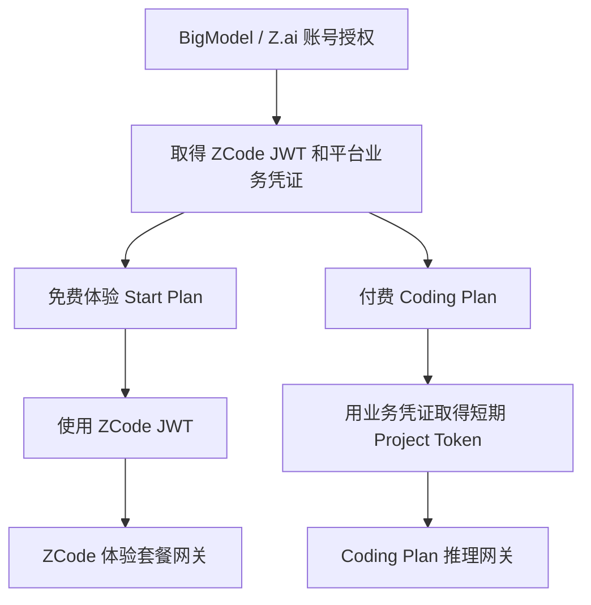

# ZCode 账号授权与免费、付费推理链路汇总

整理日期：2026-10-28

核对对象：[zai-org/ZCode](https://github.com/zai-org/ZCode)。本文基于此前核对的公开源码快照：版本 **3.16.2**，提交 **`3c5b227649371507ddc4eb46ac5133afe6db1cab`**。未使用免费或付费账号抓包、实测上游；整理时未重新核对线上变更。

## 1. 核心结论

ZCode 的账号模式可以概括为：**账号授权 → 保存 ZCode 与平台业务凭证 → 根据套餐选择推理凭证和网关 → 服务端校验权限、额度并完成模型推理。**

免费体验和付费 Coding Plan 共用账号登录体系，但使用不同的推理凭证、套餐标识和网关路径。不能理解成“同一个接口只修改免费／付费参数”。

本文讨论的是登录 BigModel / Z.ai 的账号模式。手动填写 API Key、第三方供应商或自建 Base URL 属于其他接入方式，应分别分析。

## 2. 账号授权与凭证

客户端支持授权回调和轮询两种完成方式。回调方式将授权码交给 `https://zcode.z.ai/api/v1/oauth/token`，携带 provider、code、redirect_uri 和 state；完成登录后统一形成账号凭证。

| 凭证 | 主要用途 |
| --- | --- |
| ZCode JWT | 访问 ZCode 自身服务，包括免费体验套餐 |
| 平台业务 Access Token | 访问 BigModel / Z.ai 的账号、组织、项目及套餐业务接口，并进一步取得付费推理凭证 |

- **BigModel**：客户端读取授权交换响应里的 ZCode JWT 和 BigModel 业务令牌。
- **Z.ai**：取得授权令牌后，还通过 `/api/auth/z/login` 转换为平台业务登录凭证。
- 两类令牌不能混用。源码明确指出，将 ZCode JWT 当成 BigModel 业务令牌，会导致付费套餐查询报令牌失效。
- 本地凭据服务将凭据值加密后持久化，不直接写入普通模型配置。

## 3. 免费与付费的分支

请求凭证选择代码存在明确分支：`start-plan` 读取 `zcodeJwtToken`；个人 Coding Plan 加载个人项目凭证；团队 Coding Plan 解析组织／项目凭证。后两者使用取得的短期 Project Access Token。

| 比较项 | 免费体验 Start Plan | 付费 Coding Plan |
| --- | --- | --- |
| 账号入口 | BigModel / Z.ai 授权 | BigModel / Z.ai 授权 |
| 内部套餐类型 | `start-plan` | `individual-coding-plan` / `team-coding-plan` |
| 推理凭证 | ZCode JWT | 短期 Project Access Token |
| 权益来源 | ZCode 体验套餐实例和额度桶 | Coding Plan 订阅及个人／团队上下文 |
| 模型通道 | `zcode-plan` 网关 | `ultra` / `ultra-zai` 网关 |

## 4. 付费模式的短期 Project Token

付费模式不会简单地把平台登录令牌直接用于模型推理。客户端会依次：

1. 查询账号所属组织和项目。
2. 定位或创建用于 Coding Plan 的 Key 条目。
3. 为该条目申请短期 Project Access Token。
4. 在内存中缓存令牌，并根据有效期刷新。
5. 使用短期令牌发送模型请求。

团队模式还绑定具体组织和项目。代码会校验请求期间账号／项目是否变化，避免沿用旧身份的凭证。

**平台登录令牌、Key 条目 ID、短期推理 Token 是三个不同概念。**部分接口或字段沿用 `apiKey` 命名，不代表其中存放的就是用户手动配置的长期 API Key。

## 5. 推理端点与运行时路由

以下为所检查公开版本、默认配置及对应路由装配下的路径：

| 模式 | 默认推理 URL |
| --- | --- |
| BigModel 免费体验 | `https://zcode.z.ai/api/v1/zcode-plan/anthropic/v1/messages` |
| Z.ai 免费体验 | `https://zcode.z.ai/api/v1/zcode-plan/anthropic/v1/messages` |
| BigModel 个人／团队付费 | `https://zcode.z.ai/api/v1/ultra/anthropic/v1/messages` |
| Z.ai 个人／团队付费 | `https://zcode.z.ai/api/v1/ultra-zai/anthropic/v1/messages` |

付费 Provider 的内置 Base URL 表面上分别是 `https://open.bigmodel.cn/api/anthropic` 和 `https://api.z.ai/api/anthropic`。但公开实现的端点路由层会将匹配的 `/v1/messages` 请求改写到 ZCode 的 `ultra` / `ultra-zai` 网关。

因此，**配置中的 Base URL 不一定等于最终发出的请求地址**。上述路由只针对代码匹配的地址，不能外推为所有模型、所有第三方供应商或所有部署方式都经过 ZCode 网关。

## 6. 免费与付费的额度管理

免费体验通过 `/api/v1/zcode-plan/billing/balance` 查询套餐实例和额度桶。客户端根据服务端返回的状态、有效期、模型能力与余额信息，决定展示内容和可用模型。源码也提供体验方案预览与领取相关接口。

付费 Coding Plan 使用独立的订阅权益查询，并结合个人或团队组织／项目上下文。两者共享部分客户端基础设施，但不是相同的权益来源。

修改本地配置不等于获得付费权益。客户端可用性判断也不能证明服务端实际放行；最终权限和扣费行为仍由远端执行。

具体体验期限、模型和额度以官方当前说明及账号接口返回为准。静态源码可能包含旧文案，且内置 Provider 配置支持远端更新，不宜把某个静态数值当成永久规则。

## 7. 已确认与未确认的范围

| 判断 | 核对状态 |
| --- | --- |
| 账号登录形成 ZCode JWT 和平台业务凭证 | 源码确认 |
| Start Plan 与付费 Coding Plan 使用不同推理凭证 | 源码确认 |
| 公开路由实现将对应付费 Anthropic 请求改写到 ultra 网关 | 源码确认 |
| 免费、付费账号在当前线上部署中均能成功调用 | 未实测 |
| 网关后面是否共用模型实例或算力队列 | 无法仅凭公开客户端源码确认 |
| 云端完整鉴权、反滥用和扣费实现 | 本次所检查代码不足以确认 |

## 8. 源码阅读入口

以下源码链接固定到核对提交，避免主分支后续变动造成定位不一致。

| 阅读目标 | 源码 |
| --- | --- |
| 官方源码快照 | [仓库与提交](https://github.com/zai-org/ZCode/tree/3c5b227649371507ddc4eb46ac5133afe6db1cab) |
| BigModel 授权交换 | [bigmodelProviderAdapter.ts](https://github.com/zai-org/ZCode/blob/3c5b227649371507ddc4eb46ac5133afe6db1cab/packages/services/src/oauth/providers/bigmodelProviderAdapter.ts#L176) |
| Z.ai 授权交换 | [zaiProviderAdapter.ts](https://github.com/zai-org/ZCode/blob/3c5b227649371507ddc4eb46ac5133afe6db1cab/packages/services/src/oauth/providers/zaiProviderAdapter.ts#L359) |
| 回调与轮询协调 | [oauthService.ts](https://github.com/zai-org/ZCode/blob/3c5b227649371507ddc4eb46ac5133afe6db1cab/packages/services/src/oauth/oauthService.ts#L625) |
| 凭据加密持久化 | [credentialService.ts](https://github.com/zai-org/ZCode/blob/3c5b227649371507ddc4eb46ac5133afe6db1cab/packages/services/src/credential/credentialService.ts#L16) |
| 免费／付费请求凭证分支 | [accountProviderRequestAuthService.ts](https://github.com/zai-org/ZCode/blob/3c5b227649371507ddc4eb46ac5133afe6db1cab/packages/services/src/model-provider/accountProviderRequestAuthService.ts#L78) |
| 短期 Project Token | [project-access-token-client.ts](https://github.com/zai-org/ZCode/blob/3c5b227649371507ddc4eb46ac5133afe6db1cab/packages/shared/src/project-access-token-client.ts#L195) |
| 内置 Provider 配置 | [zcode-builtin.json](https://github.com/zai-org/ZCode/blob/3c5b227649371507ddc4eb46ac5133afe6db1cab/config/provider/zcode-builtin.json#L715) |
| 最终端点改写 | [official-coding-plan-gateway.ts](https://github.com/zai-org/ZCode/blob/3c5b227649371507ddc4eb46ac5133afe6db1cab/apps/zcode-cli/packages/adapters/src/model/official-coding-plan-gateway.ts#L8) |
| 体验套餐余额查询 | [zaiStartPlanBilling.ts](https://github.com/zai-org/ZCode/blob/3c5b227649371507ddc4eb46ac5133afe6db1cab/packages/services/src/model-provider/zaiStartPlanBilling.ts#L71) |
| 套餐可用性判断 | [codingPlanProviderAvailability.ts](https://github.com/zai-org/ZCode/blob/3c5b227649371507ddc4eb46ac5133afe6db1cab/packages/services/src/model-provider/codingPlanProviderAvailability.ts#L393) |
| 官方接入说明（在线更新） | [连接模型与套餐](https://zcode.z.ai/cn/docs/configuration) |
